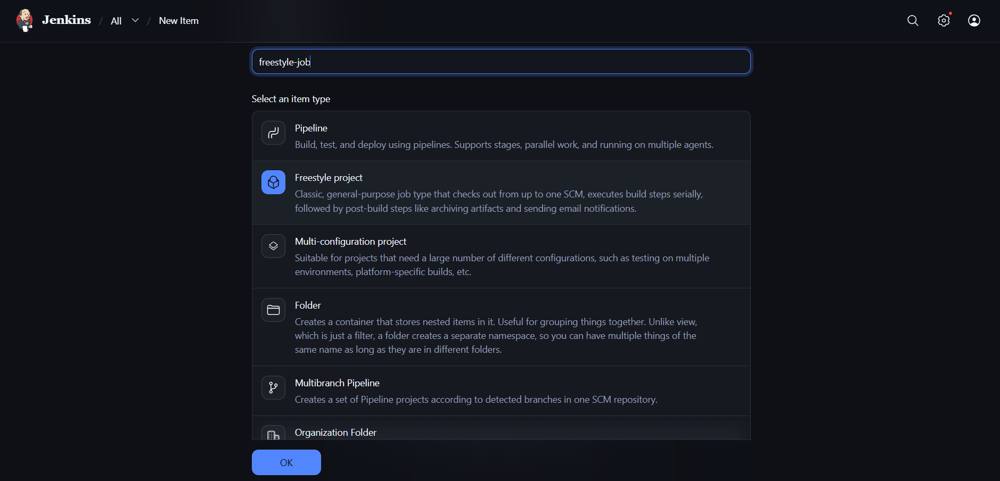
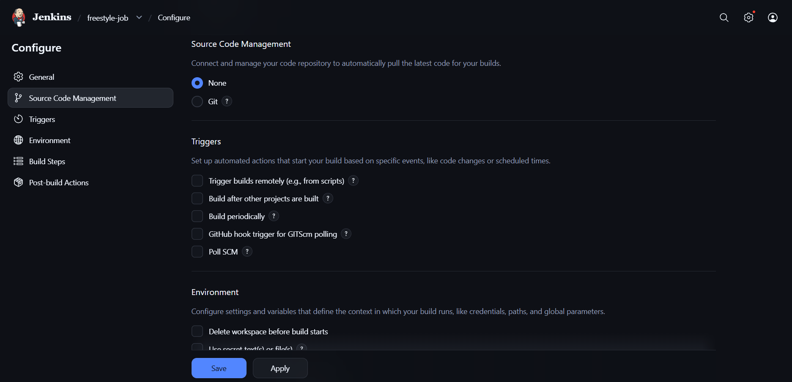
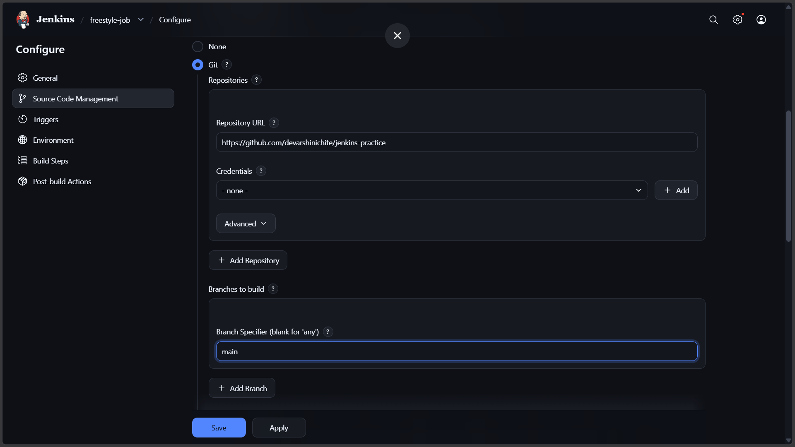
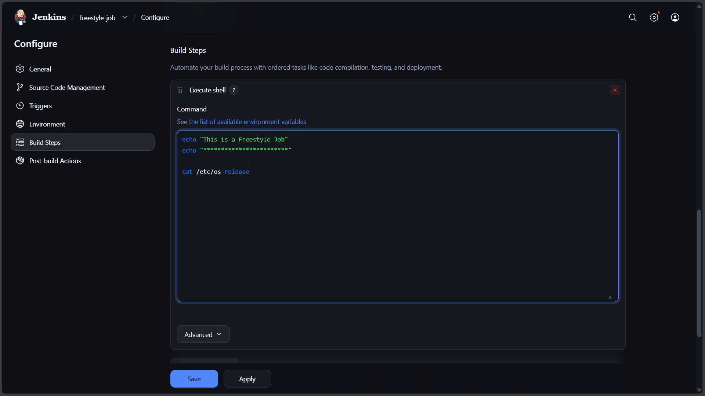
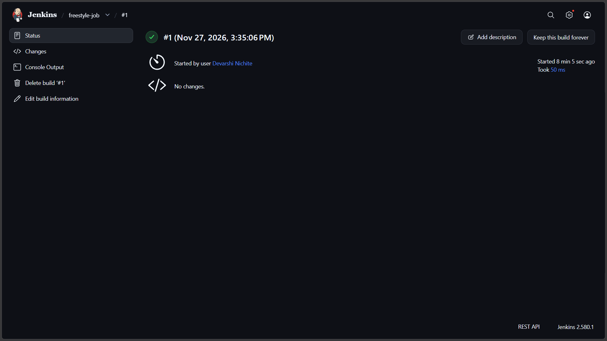
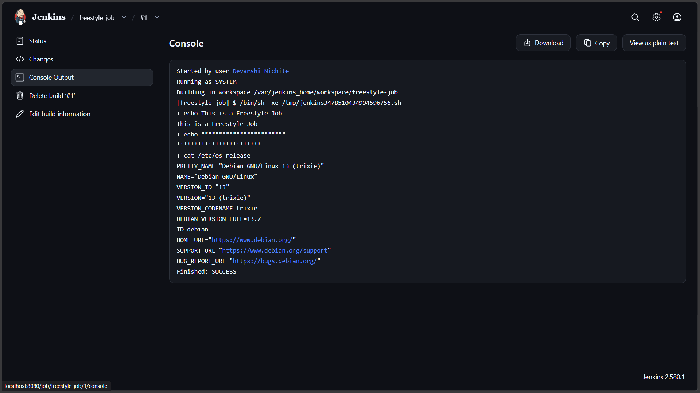

# Lab 01 – Jenkins Freestyle Job

<details>
<summary>Lab status</summary>

Completed as part of the Jenkins CI/CD course.

</details>

## Objective

Understand how to create and configure a basic Jenkins job through the web interface, and learn the relationship between source checkout, build steps, and build results.

## Concepts practised

- Creating a Freestyle project.
- Configuring a job through the Jenkins UI.
- Connecting a job to source control where required by the exercise.
- Defining build steps and observing console output.
- Understanding build status and build history.

For a detail code snippets and files checkout my detailed Code snippets, Jenkinsfile, Dockerfile - [Jenkins Practice](https://github.com/devarshinichite/jenkins-practice)

## Environment

The course exposed Jenkins in multiple environments, including a local machine, Docker, and EC2. The exact environment and configuration may differ between course exercises.

## General workflow

1. Open the Jenkins dashboard.
2. Create a new Freestyle project.
3. Configure the source repository and branch if the exercise uses SCM.
4. Add the required build step(s).
5. Save and run the job.
6. Inspect Console Output and the build result.
7. Make a small change or rerun the job to understand how build history is recorded.

## What this lab demonstrates

A Freestyle job is a useful introduction to Jenkins job configuration. It demonstrates that Jenkins can coordinate checkout and command execution without requiring a Jenkinsfile.

## Limitations and next step

Freestyle configuration is primarily stored in Jenkins job configuration rather than alongside application source code. A Pipeline job moves workflow definition into a Jenkinsfile, making it easier to version, review, and reproduce.

## Screenshots & Exec shell Snippet

### Exec Snippet
```
echo "This is a Freestyle Job"
echo "************************"

cat /etc/os-release
```

`Display Linux system file containing operating system information.`

### Screenshot
- Jenkins freestyle job creation.
    

- Freestyle Job Dashboard :
    - Source control management (Git, GitHub repo)
        

        
    
    - Environmental Variables :
        
        

- Successful build page.
    
    
- Console Output showing the executed build steps.
    

## Notes

*Above Subject and Content to change - The current available learning history confirms completion of Freestyle hands-on work but does not preserve the exact repository URL, build commands, or final job configuration.*

## Links
You can look into this repository for a more detailed Code snippets, Jenkinsfile, Dockerfile- [Jenkins Practice](https://github.com/devarshinichite/jenkins-practice)