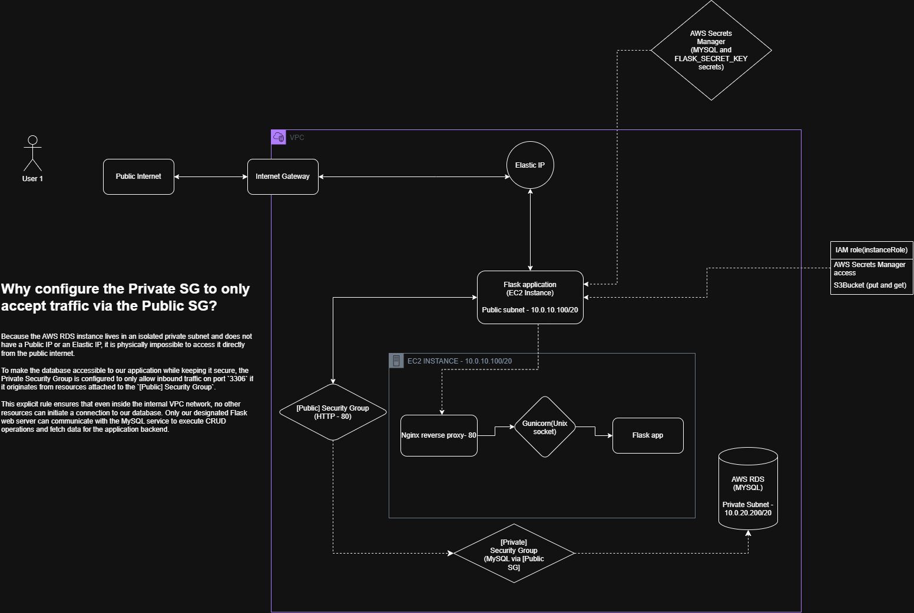

# Project 06 - 🚀 Securing a Flask App on EC2 with a Private RDS Instance & Gunicorn/Nginx

## 📌 Project Information

| Item               | Details                                              |
| ------------------ | ---------------------------------------------------- |
| **Project Name**   | Flask App on EC2 with Secrets Manager & Private RDS  |
| **Project Status** | ✅ Completed                                          |
| **Difficulty**     | ⭐⭐⭐ Intermediate / Entry-Level DevOps                  |
| **Estimated Time** | *2–3 Hours*                                          |
| **Date Completed** | *17 October 2026*                                    |
| **AWS Region**     | *ap-south-1*                                          |

---

## 📖 Project Overview

This project documents deploying a Python Flask application on an AWS EC2 instance connected to an AWS RDS MySQL database. The main focus of this project was moving away from basic local setups and focusing on network isolation, secure server hosting, and dynamic secret management. 

Instead of putting everything on the public internet or hardcoding credentials, the database is hidden inside a private subnet, the server uses a production-grade Nginx/Gunicorn stack, and the EC2 instance uses an IAM role to fetch database passwords dynamically from AWS Secrets Manager.

---

## 🎯 Project Objective

Deploy a secure, database-driven web application on AWS with the following outcomes:
* Host a Flask application inside a public subnet reachable via an Elastic IP.
* Deploy an Nginx reverse proxy routing traffic over a Unix socket to Gunicorn workers.
* Isolate the MySQL database completely within a private subnet.
* Configure network-level access control so the database only talks to the web server.
* Remove hardcoded database passwords by integrating AWS Secrets Manager via an IAM role.
* Minimize the network attack surface by leveraging the stateful nature of AWS Security Groups.

---

## 🛠 AWS Services Used

| AWS Service          | Purpose                                                            |
| -------------------- | ------------------------------------------------------------------ |
| **Amazon EC2**       | Compute (Hosts the Flask application in the public subnet)         |
| **Elastic IP**       | Provides a persistent, static public IP address for the client     |
| **Amazon RDS (MySQL)**| Managed database isolated in a private subnet                     |
| **AWS Secrets Manager**| Securely stores MySQL credentials and the `FLASK_SECRET_KEY`    |
| **IAM Role & Instance Profile** | Grants the EC2 instance least-privilege access to Secrets Manager |
| **VPC / Security Groups** | Handles network isolation and traffic restriction               |

---

## 🧠 Skills Practiced

* **Production Web Serving:** Deploying Nginx as a reverse proxy to handle external connections and isolate the application server.
* **WSGI Application Management:** Configuring Gunicorn to manage Flask processes, binding them securely via Linux Unix sockets.
* **Network Isolation Principles:** Splitting layouts into Public vs. Private Subnets to protect raw data.
* **Cloud Security Engineering:** Restricting database access strictly via Security Group chaining.
* **AWS IAM Management:** Leveraging Instance Profiles for tokenless AWS Secret Manager API requests.
* **Understanding Stateful Firewalls:** Inbound vs. Outbound security group mechanics.

---

## 🏗 Architecture

Below is the architectural layout of the infrastructure and internal application flow:



---

### ⚙️ Production Web Stack Mechanics (Inside the EC2 Instance)
To avoid running a vulnerable development server in production, the web layer is decoupled using industry-standard tools:
1. **Nginx (Reverse Proxy):** Listens publicly on Port 80, acts as the primary web entry point, and safely passes incoming traffic to an internal Unix socket.
2. **Gunicorn (WSGI Server):** Manages multiple worker processes, reads incoming requests from the shared Unix socket, and executes the Flask backend application logic.

### 💡 Why configure the Private SG to only accept traffic via the Public SG?
* **Zero Public Exposure:** Because the AWS RDS instance lives in an isolated private subnet and does not have a Public IP or an Elastic IP, it is physically impossible to access it directly from the public internet.
* **Strict Control (Least Privilege):** To make the database accessible to our application while keeping it secure, the Private Security Group is configured to only allow inbound (**Ingress**) traffic on port `3306` if it originates from resources attached to the `[Public] Security Group`. 
* **Minimized Attack Surface:** This explicit rule ensures that even inside the internal VPC network, no other resources can initiate a connection to our database. Only our designated Flask web server can communicate with the MySQL service to execute CRUD operations and fetch data for the application backend.

---

## 🔧 Server Provisioning & Service Configuration

The internals of the EC2 instance are structured to decouple web traffic handling from application execution. Below are the configurations used to keep the application running reliably as a background service.

### 1. Gunicorn Systemd Service File (`/etc/systemd/system/flask-app.service`)
The Flask application is managed as a `systemd` daemon with explicit resource quotas and backoff rate-limiting implemented to guarantee server stability:

```ini
[Unit]
Description=Gunicorn instance to serve Flask application
After=network-online.target
Wants=network-online.target

StartLimitInterval=300s
StartBurstLimit=5

[Service]
User=ubuntu
Group=www-data

WorkingDirectory=/opt/cloud-asset-manager
Environment=FLASK_ENV=production
ExecStart=/opt/cloud-asset-manager/venv/bin/gunicorn --workers 3 --bind unix:flask-app.sock wsgi:app

Restart=on-failure
RestartSec=30s

StandardOutput=journal
StandardError=journal

CPUQuota=50%
MemoryMax=500M

[Install]
WantedBy=multi-user.target
```

### 2. Nginx Reverse Proxy Configuration (`/etc/nginx/sites-available/nginx-flask-app`)
Nginx catches traffic on public port 80 and passes it directly to the Gunicorn process using the internal Unix socket file located in the application partition, avoiding local network overhead:

```nginx
server {
    listen 80;
    server_name _;

    # Reverse Proxy configuration
    location / {
        proxy_pass http://unix:/opt/cloud-asset-manager/flask-app.sock;
        
        # Standard proxy headers to preserve user context
        proxy_set_header Host $host;
        proxy_set_header X-Real-IP $remote_addr;
        proxy_set_header X-Forwarded-For $proxy_add_x_forwarded_for;
        proxy_set_header X-Forwarded-Proto $scheme;

        # Timeouts to prevent hanging connections
        proxy_connect_timeout 90s;
        proxy_send_timeout 90s;
        proxy_read_timeout 90s;
    }

    # Custom log paths for easier troubleshooting
    error_log  /var/log/nginx/flaskapp_error.log;
    access_log /var/log/nginx/flaskapp_access.log;
}
```

### 3. IAM Role and Policy (instanceRole)
IAM Role attached to the EC2 Instance Profile grants the Flask application secure, temporary credentials to interact with AWS resources without hardcoding access keys.

``` IAM Policy 
{
    "Version": "2012-10-17",
    "Statement": [
        {
            "Sid": "FlaskSecrets",
            "Effect": "Allow",
            "Action": [
                "secretsmanager:GetSecretValue"
            ],
            "Resource": "arn:aws:secretsmanager:ap-south-1:123456789012:secret:production/cloud-asset-manager/secrets"
        }
    ]
}
```

---

## 📦 Application & Environment Integration

While the core focus of this project repository is cloud infrastructure configuration, the deployed system runs my **[Flask Application](https://github.com/devarshinichite/cloud-asset-manager)**. The codebase has been kept in its own separate repository to mimic real-world production setups, separating application code from infrastructure management. 

The application logic inside `config.py` was built to be completely environment-aware, executing the following dynamic check:

### 🔄 Runtime Environment Detection Flow
When the application process initializes inside the Gunicorn worker, it executes the following logic:

1. **Production Mode:** The app checks for the environment variable `FLASK_ENV=production` (injected via our `systemd` service file). 
2. **AWS Secrets Manager Check:** It invokes the `boto3` client to fetch the database credentials (`DB_PASSWORD`) and the application `FLASK_SECRET_KEY` directly from the AWS Secrets Manager API using the EC2 instance's IAM role.
3. **Local Development Fallback:** If the AWS API call fails or if the application is run locally without an IAM role, the system gracefully falls back to a local development configuration (such as a local SQLite or development MySQL instance).

This decoupling ensures that the exact same application code can be tested locally on a laptop without needing cloud access, while remaining completely secure and credential-free when deployed to AWS production.

---

## 🛡️ Security Group Rules

### 1. Public Security Group (`[Public] Security Group`)
Attached to the EC2 instance to control frontend traffic. Note that port 3306 is **not** open for inbound traffic here, as the instance acts strictly as a database client making outbound connections.

| Type  | Protocol | Port | Source    | Purpose |
| ----- | -------- | ---- | --------- | ------- |
| SSH   | TCP      | 22   | My IP     | Secure administrative server access |
| HTTP  | TCP      | 80   | 0.0.0.0/0 | Allows public internet traffic to hit Nginx |

### 2. Private Security Group (`[Private] Security Group`)
Attached to the RDS instance to lock down database access:

| Type  | Protocol | Port | Source | Purpose |
| ----- | -------- | ---- | ------ | ------- |
| MySQL | TCP      | 3306 | `[Public] Security Group` | **Strict Isolation:** Only accepts traffic originating from instances inside the Public SG |

---

## 🚀 Deployment Process

1. **Database Isolation:** Set up a DB subnet group using private subnets, launch the Amazon RDS instance inside it, and verify it does not have a public IP address.
2. **Secret Configurations:** Create a new secret entry in AWS Secrets Manager containing the MySQL root password and application secret keys.
3. **IAM Permissions:** Create an IAM role with custom permissions to access Secrets Manager and attach it to the EC2 instance as an Instance Profile.
4. **Network Access Policies:** Create the `[Public]` and `[Private]` security groups. Map the inbound rule of the Private SG to accept traffic exclusively from the Public SG ID.
5. **Application Start:** Transfer application files to `/opt/flask-application`, initialize the Python environment, configure the `systemd` and `nginx` config blocks, and launch services.

---

## ⚠ Challenges Encountered

### Challenge 1 — Accessing Secrets Manager from the App
* **Symptoms:** Code threw an `AccessDeniedException` when initializing or trying to pull configuration strings.
* **Cause:** The EC2 instance did not have the right IAM permissions attached yet, or the policy statement lacked the exact secret resource ARN.
* **Resolution:** I verified the `instanceRole` attachment on the EC2 management console, updated the JSON policy definition to precisely reference the Secrets Manager resource, and restarted the application process.

### Challenge 2 — Database Connection Timeouts
* **Symptoms:** Flask logs showed connection errors like `OperationalError: (2003, "Can't connect to MySQL server")`.
* **Cause:** The database was sitting securely in the private subnet, but the private security group rules were blocking port 3306 traffic from the public subnet.
* **Resolution:** I updated the inbound rules on the database's `[Private] Security Group` to allow port `3306` traffic, explicitly setting the source filter to target the `[Public] Security Group` ID instead of a broad IP range.

---

## 📚 Key Concepts Learned

* **Stateful Firewalls:** Learned that AWS Security Groups track connection states. Because outbound traffic is allowed by default, the client instance does not need an inbound rule to receive the database's response.
* **Least Privilege:** Cloud resources should never use raw user keys. Using instance roles ensures that if the server is compromised, the broader cloud environment stays safe.
* **Network Segregation:** Keep internal layers (like databases) completely hidden away from the public internet to decrease the attack surface.

---

## 🔄 Future Improvements / Scope

As I build upon this baseline architecture, I plan to roll out improvements across future phases:

- **High Availability (ALB):** Remove the Elastic IP bottleneck and place the EC2 instance behind an Application Load Balancer inside an Auto Scaling Group across multiple Availability Zones.
- **AWS Cloudwatch :** Create a CloudWatch alarm to actively monitor and log activities. 
- **Domain & Firewalls:** Point a custom Route 53 domain name to the load balancer and place AWS WAF in front to check incoming requests for web vulnerabilities.
- **VPC Endpoints:** Configure a VPC Endpoint for AWS Secrets Manager so that the EC2 instance can fetch its credentials entirely within the internal AWS private network.
- **Infrastructure as Code (IaC):** Convert this manual infrastructure setup into clean Terraform manifests for repeatable deployments.

---

## 📝 Personal Reflection

Building this project taught me that setting up a cloud application requires careful planning around network permissions. It was highly rewarding to see the Flask app successfully fetch its secrets from AWS Secrets Manager using an attached role instead of reading from a plaintext environment file. Learning how stateful security groups behave helped me write a cleaner configuration that leaves fewer entry points exposed to the internet.
